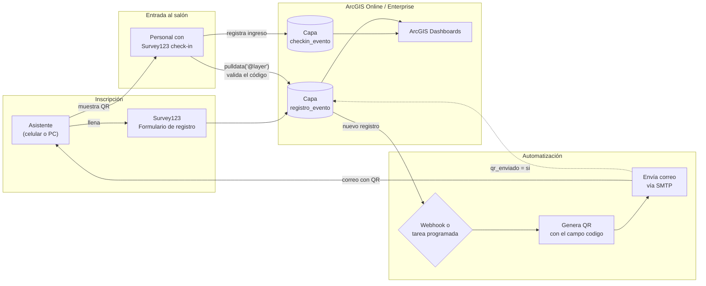
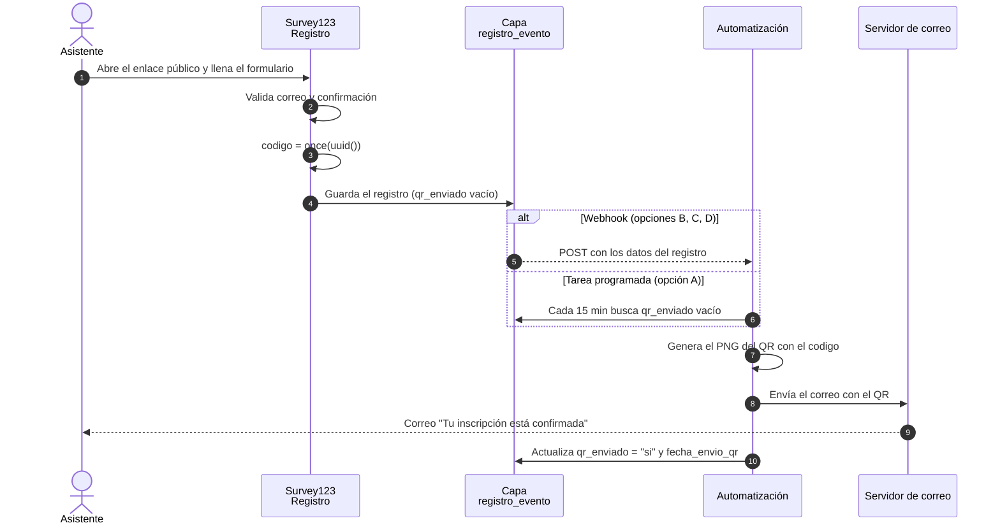
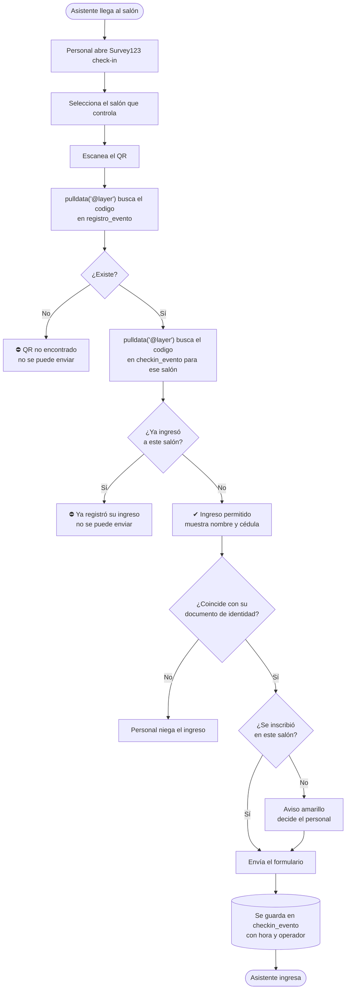
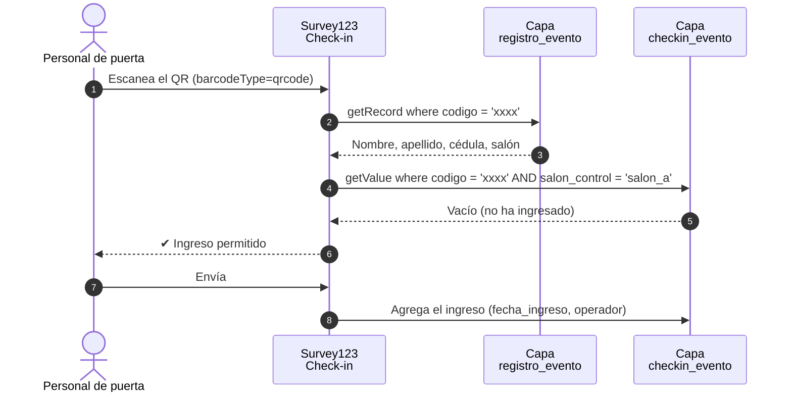
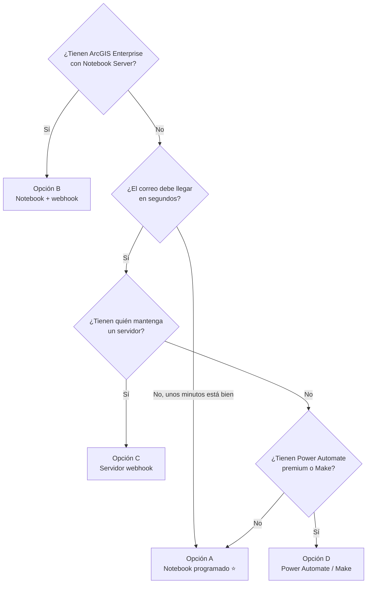
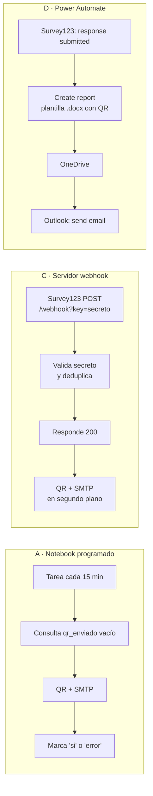
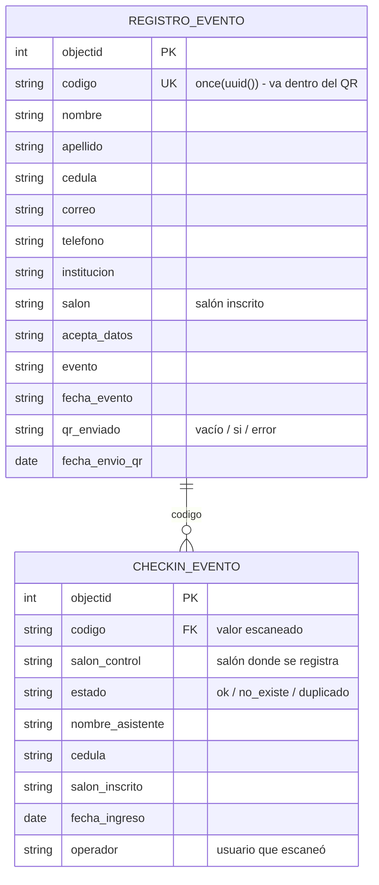
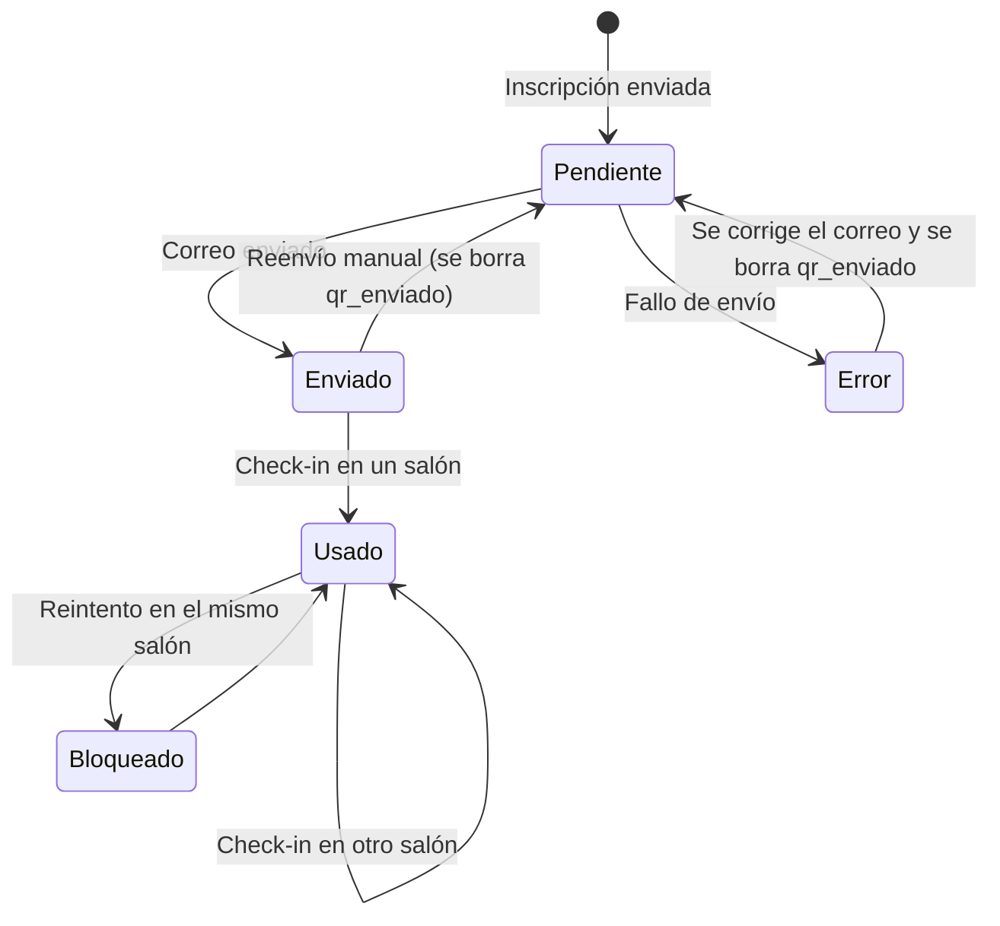
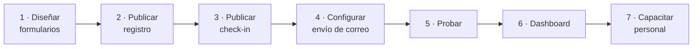

# Registro de eventos con código QR en ArcGIS Survey123

Solución para inscribir asistentes a un evento con **Survey123**, enviarles **automáticamente un código QR por correo** y **controlar el ingreso a los salones** escaneando ese QR. No necesita comprar un sistema de registro externo: todo funciona con herramientas de ArcGIS que la organización ya tiene.

---

## Índice
1. [Qué resuelve](#1-qué-resuelve)
2. [Arquitectura](#2-arquitectura)
3. [Requisitos](#3-requisitos)
4. [Flujo de trabajo del inscrito](#4-flujo-de-trabajo-del-inscrito)
5. [Flujo de trabajo en la puerta (check-in)](#5-flujo-de-trabajo-en-la-puerta-check-in)
6. [¿Cómo se envía el correo? Opciones de automatización](#6-cómo-se-envía-el-correo-opciones-de-automatización)
7. [Modelo de datos](#7-modelo-de-datos)
8. [Ciclo de vida del QR](#8-ciclo-de-vida-del-qr)
9. [Implementación paso a paso](#9-implementación-paso-a-paso)
10. [Plan de pruebas](#10-plan-de-pruebas)
11. [Seguridad y privacidad](#11-seguridad-y-privacidad)
12. [Limitaciones conocidas](#12-limitaciones-conocidas)
13. [Referencias oficiales de Esri](#13-referencias-oficiales-de-esri)

---

## 1. Qué resuelve

| Necesidad | Cómo se cubre |
|---|---|
| Inscripción en línea | Formulario público de Survey123 (web, sin instalar nada) |
| Entrada personal e intransferible | Cada inscrito recibe un QR con un código único aleatorio |
| Envío automático por correo | Webhook de Survey123 o ArcGIS Notebook programado |
| Control en la puerta | Formulario de check-in en Survey123 que escanea el QR con la cámara |
| Evitar fraudes | Valida que el QR exista, que no se haya usado en ese salón y muestra la cédula |
| Asistencia en tiempo real | Los ingresos quedan en una capa de ArcGIS → ArcGIS Dashboards |

---

## 2. Arquitectura

**Componentes**

| Componente | Herramienta | Función |
|---|---|---|
| Formulario de registro | Survey123 (XLSForm en Survey123 Connect) | Captura datos y genera el `codigo` único |
| Capa de registro | Hosted feature layer | Guarda inscritos y estado del envío del QR |
| Automatización | ArcGIS Notebook, servidor webhook o Power Automate | Genera el QR y envía el correo |
| Formulario de check-in | Survey123 con pregunta `barcode` | Escanea, valida y registra el ingreso |
| Capa de check-in | Hosted feature layer | Guarda cada ingreso: quién, dónde, cuándo y quién lo registró |
| Tablero | ArcGIS Dashboards | Inscritos vs. asistentes, ingresos por salón |

---

## 3. Requisitos

### 3.1 Requisitos funcionales

| ID | Requisito |
|---|---|
| RF-01 | El asistente se inscribe en un formulario público con nombres, apellidos, cédula, correo, teléfono, institución y salón. |
| RF-02 | El correo se valida con formato y se pide confirmarlo. |
| RF-03 | Al inscribirse, el sistema genera un código único no adivinable. |
| RF-04 | El asistente recibe un correo con su QR incrustado y adjunto en PNG. |
| RF-05 | El personal escanea el QR con un celular o tablet. |
| RF-06 | Al escanear se muestran nombre, cédula y salón inscrito. |
| RF-07 | Se bloquea el registro si el QR no existe o ya ingresó a ese salón. |
| RF-08 | Se avisa si la persona se inscribió en otro salón. |
| RF-09 | Cada ingreso guarda fecha y hora, salón y usuario que lo registró. |
| RF-10 | Los fallos de envío quedan marcados para reintentar. |

### 3.2 Requisitos no funcionales

| ID | Requisito |
|---|---|
| RNF-01 | El QR no contiene datos personales, solo un UUID. |
| RNF-02 | Las credenciales de correo no se guardan en el código. |
| RNF-03 | El público solo puede **agregar** registros, no ver los de otros. |
| RNF-04 | El correo llega en minutos (notebook) o segundos (webhook). |
| RNF-05 | El check-in responde en pocos segundos con conexión a internet. |

### 3.3 Requisitos técnicos

| Recurso | Detalle | Obligatorio |
|---|---|---|
| Cuenta ArcGIS Online o Enterprise | Rol con privilegios para publicar contenido | Sí |
| Survey123 Connect | Para publicar los XLSForm (barcode, `pulldata("@layer")`) | Sí |
| App de campo Survey123 o navegador | Para el personal de puerta | Sí |
| Cuenta de correo con SMTP | Gmail con contraseña de aplicación, Microsoft 365 o correo institucional | Sí (opciones A, B, C) |
| Privilegio *Schedule notebooks* y créditos | Solo para la opción A | Según opción |
| ArcGIS Enterprise con Notebook Server | Solo para la opción B | Según opción |
| Servidor con HTTPS público | Solo para la opción C | Según opción |
| Power Automate con conectores premium o Make | Solo para la opción D | Según opción |
| Internet en la puerta | `pulldata("@layer")` solo funciona en línea | Sí |

---

## 4. Flujo de trabajo del inscrito

---

## 5. Flujo de trabajo en la puerta (check-in)

---

## 6. ¿Cómo se envía el correo? Opciones de automatización

Survey123 no envía correos personalizados por sí solo. Algo tiene que reaccionar a cada inscripción.

| Opción | Dónde corre | Velocidad | Ventaja | Consideración |
|---|---|---|---|---|
| **A. ArcGIS Notebook programado** | ArcGIS Online | Cada ~15 min | 100% ArcGIS, sin servidores, QR generado localmente | Consume créditos |
| **B. Notebook Server + webhook** | ArcGIS Enterprise | Inmediato | Todo dentro de Enterprise | Requiere Notebook Server |
| **C. Servidor webhook propio** | Hosting propio (Docker) | Inmediato | Control total, sin costo de créditos | Hay que mantener un servidor HTTPS |
| **D. Power Automate o Make** | Nube externa | Inmediato | Sin programar, usa plantilla de reporte | Licencia premium. El QR lo dibuja un servicio externo |

**Recomendación:** opción **A**. No necesita infraestructura externa, el código vive en la organización y ningún dato sale a servicios de terceros. Se puede combinar con C o D: si el webhook falla, el notebook envía a quienes quedaron pendientes.

### Detalle de cada opción

---

## 7. Modelo de datos

Campos que **no deben renombrarse** sin actualizar la automatización: `codigo`, `correo`, `nombre`, `apellido`, `qr_enviado`, `fecha_envio_qr`.

---

## 8. Ciclo de vida del QR

---

## 9. Implementación paso a paso

### Paso 1 — Diseñar los formularios
Crear dos XLSForm en Survey123 Connect.

**Registro** (`registro_evento`):

| type | name | calculation / constraint |
|---|---|---|
| text | nombre, apellido, cedula | requeridos |
| text | correo | `regex(., '^[^@\s]+@[^@\s]+\.[A-Za-z]{2,}$')` |
| text | correo_confirmacion | `. = ${correo}`, `bind::esri:fieldType = null` |
| select_one salones | salon | requerido |
| calculate | codigo | `once(uuid())` |
| hidden | qr_enviado | lo llena la automatización |
| dateTime | fecha_envio_qr | appearance `hidden` |

**Check-in** (`checkin_evento`):

| type | name | calculation |
|---|---|---|
| select_one salones | salon_control | requerido |
| barcode | codigo | `body::esri:style = barcodeType=qrcode` |
| text (hidden) | reg_json | `pulldata('@layer', 'getRecord', ${url_registro}, concat("codigo='", ${codigo}, "'"))` |
| calculate | ingreso_previo | `pulldata('@layer', 'getValue', 'attributes.objectid', concat(${url_checkin}, '?t=', now()), concat("codigo='", ${codigo}, "' AND salon_control='", ${salon_control}, "'"))` |
| calculate | estado | `ok` / `no_existe` / `duplicado` |
| text (readonly) | nombre_asistente, cedula, salon_inscrito | `pulldata('@json', ${reg_json}, 'attributes.nombre')` |
| text | bloqueo | requerido, `constraint = false()`, visible solo si el estado no es `ok` |
| dateTime | fecha_ingreso | `once(now())` |
| calculate | operador | `pulldata('@property', 'username')` |

El campo `bloqueo` es el truco que impide enviar el formulario: solo aparece cuando el QR no es válido, es obligatorio y su restricción nunca se cumple.

### Paso 2 — Publicar el registro
1. Publicar desde Survey123 Connect.
2. Compartir con **Everyone** (público).
3. Copiar la URL de la capa (`.../FeatureServer/0`).
4. Para webhooks: activar **Keep track of changes to the data** en la configuración de la capa.

### Paso 3 — Publicar el check-in
1. Publicar el segundo formulario y copiar la URL de su capa.
2. Pegar ambas URLs en `url_registro` y `url_checkin` y **republicar**.
3. Compartir el check-in con un **grupo del personal**. Ese grupo también debe poder leer la capa de registro.

### Paso 4 — Configurar el envío de correo
Según la opción elegida en la [sección 6](#6-cómo-se-envía-el-correo-opciones-de-automatización):

- **A:** subir el notebook a ArcGIS Online y guardar las credenciales SMTP en un ítem JSON **privado**. Probar con `MODO_PRUEBA = True` y crear una tarea cada 15 min.
- **B:** publicar el notebook en Enterprise y asociarlo al webhook de la capa.
- **C:** desplegar el servidor con Docker. Registrar el webhook en *Survey123 → Settings → Webhooks* con la URL `https://servidor/webhook?key=SECRETO` y el evento *New record submitted*.
- **D:** subir la plantilla de reporte con la línea `${$image | src:"https://barcode.tec-it.com/barcode.ashx?code=QRCode&data="+codigo | size:250:250}`. Crear el flujo *When a survey response is submitted → Create report → Send an email*.

### Paso 5 — Probar
Ver la [sección 10](#10-plan-de-pruebas).

### Paso 6 — Dashboard
ArcGIS Dashboards con:
- un indicador de inscritos;
- un indicador de ingresos;
- ingresos por `salon_control`;
- una lista de los últimos ingresos.

### Paso 7 — Capacitar al personal de puerta
1. Instalar la app de campo de Survey123 e iniciar sesión.
2. Descargar el formulario de check-in.
3. Guardar el salón como respuesta favorita.
4. Practicar los tres casos: válido, duplicado y QR ajeno.

---

## 10. Plan de pruebas

| # | Caso | Resultado esperado |
|---|---|---|
| 1 | Inscribirse con un correo propio | Llega el correo con el QR (revisar spam) |
| 2 | Correo y confirmación distintos | El formulario no deja enviar |
| 3 | Escanear el QR en el salón inscrito | ✔ Ingreso permitido, muestra nombre y cédula |
| 4 | Escanear el mismo QR en el mismo salón | ⛔ Bloqueado |
| 5 | Escanear el mismo QR en otro salón | ✔ con aviso amarillo |
| 6 | Escanear un QR cualquiera (web, producto) | ⛔ Bloqueado |
| 7 | Correo inexistente | `qr_enviado = error`; al corregirlo y borrar el valor, se reenvía |
| 8 | Webhook entregado dos veces | Un solo correo |
| 9 | Sin internet en la puerta | No valida; el personal debe saberlo |

---

## 11. Seguridad y privacidad

- **El QR solo contiene un UUID aleatorio.** No lleva nombre ni cédula y no se puede adivinar.
- **Verificación de identidad:** al escanear se muestra la cédula para compararla con el documento físico.
- **Vistas de Survey123:** el público solo puede agregar registros; los resultados son privados.
- **Credenciales:** el SMTP se guarda en un ítem privado (notebook) o en variables de entorno (servidor), nunca en el código.
- **Webhook:** Survey123 no firma las peticiones, por eso se usa un secreto en la URL. Además se deduplican los envíos, porque un webhook puede llegar más de una vez.
- **Normativa:** ajustar la pregunta de consentimiento a la Ley Orgánica de Protección de Datos Personales de Ecuador.

---

## 12. Limitaciones conocidas

| Limitación | Impacto | Mitigación |
|---|---|---|
| `pulldata("@layer")` solo funciona en línea | Sin internet no se valida el QR | Wifi o datos móviles dedicados en cada puerta |
| La opción A no es inmediata | El correo puede tardar hasta el intervalo de la tarea | Ejecutar el notebook a mano para inscripciones en sitio, o combinar con C/D |
| Las tareas programadas y los reportes consumen créditos | Costo en ArcGIS Online | Medir el consumo unos días antes |
| La opción D usa un generador de QR externo | El `codigo` sale a un tercero | Usar A o C si no está permitido |
| Límites diarios del proveedor de correo | Gmail limita los envíos por día | Cuenta institucional o Microsoft 365 para eventos grandes |

---

## 13. Referencias oficiales de Esri

- [Survey123 – Barcodes](https://doc.arcgis.com/en/survey123/create-surveys/barcodes.htm)
- [Survey123 – Formulas: `pulldata("@layer")`, `once()`, `uuid()`](https://doc.arcgis.com/en/survey123/create/main/xlsformformulas.htm)
- [Survey123 – Webhooks](https://doc.arcgis.com/en/survey123/browser/analyze-results/webhooks.htm)
- [Esri Developer – Automate workflows with webhooks](https://developers.arcgis.com/documentation/app-builders/low-code/arcgis-survey123/automate-workflows-with-webhooks/)
- [Survey123 – Report templates](https://doc.arcgis.com/en/survey123/browser/analyze-results/featurereporttemplates.htm)
- [ArcGIS Online – Manage scheduled notebook tasks](https://doc.arcgis.com/en/arcgis-online/create-maps/manage-scheduled-tasks.htm)
- [ArcGIS Notebook Server – Automate workflows](https://doc.esri.com/en/arcgis-notebooks/latest/administer/automate-notebook-execution.html)
- [Esri Support – Automatizar correos con reportes de Survey123 en Power Automate](https://support.esri.com/en-us/knowledge-base/how-to-automate-email-notifications-with-survey-reports-000034101)
- [Esri Community – Tricks of the Trade: `pulldata("@layer")`](https://community.esri.com/discussion/1224415/survey123-tricks-of-the-trade-pulldata-layer)
